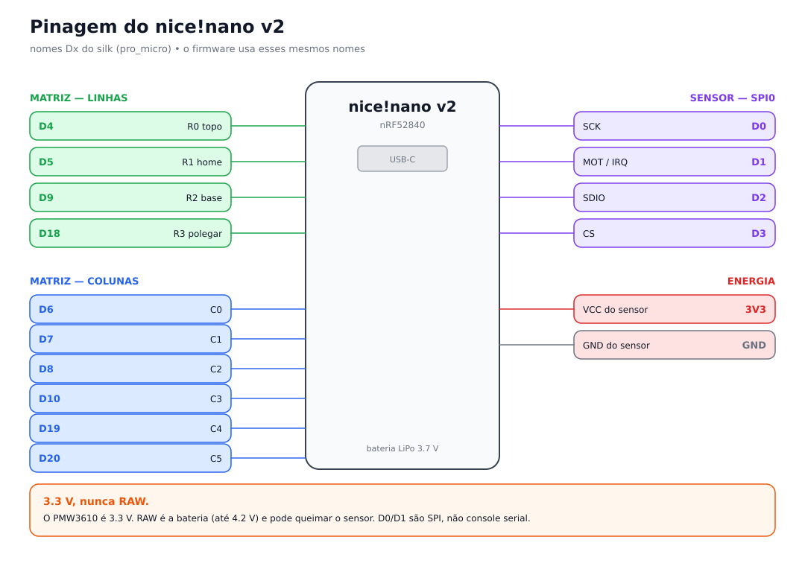
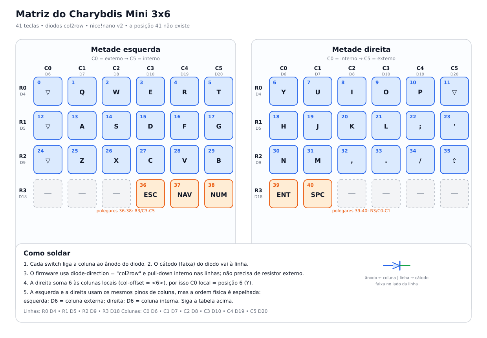
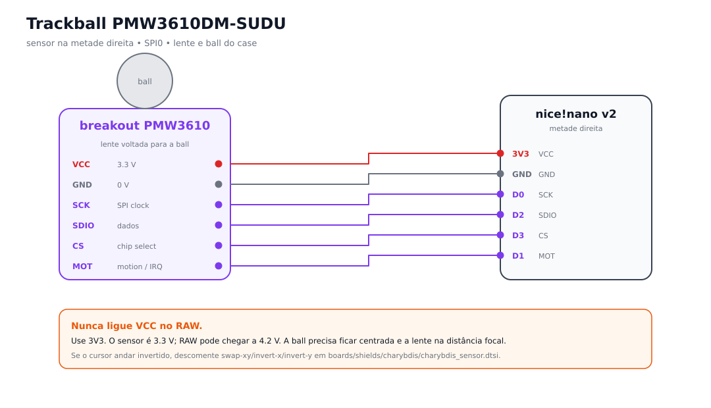
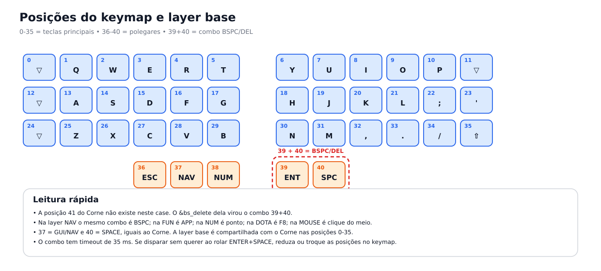
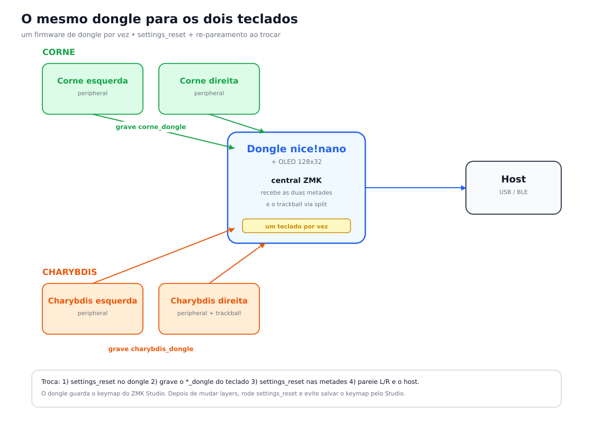

# Charybdis Mini 3x6 handwired (41 teclas + trackball)

Este documento descreve o segundo teclado do repositório: um **Charybdis Mini
3x6 handwired**, com **41 teclas** e **trackball PMW3610DM-SUDU** na metade
direita. Ele usa o **mesmo dongle** do Corne (um nice!nano v2 com OLED), então
os dois teclados continuam no mesmo repositório e no mesmo
[keymap-editor](https://nickcoutsos.github.io/keymap-editor/), mas **não
funcionam ao mesmo tempo**.

O firmware e este guia estão no branch `charybdis`. O Corne continua com as 42
teclas e o keymap original; as 36 teclas principais (posições 0-35) são
compartilhadas entre os dois keymaps. Os polegares 36-40 começam iguais, mas o
Charybdis tem só cinco; a posição 41 do Corne não existe nele.

## Resumo do hardware

| Item | Charybdis Mini 3x6 |
|---|---|
| Teclas | 41 (3x6 por metade + 3 polegares na esquerda + 2 na direita) |
| Controladores | 2 nice!nano v2 nas metades + o dongle existente do Corne |
| Dongle | nice!nano v2 com OLED 128x32, central ZMK |
| Diodos | 41 × 1N4148 (ou equivalente), `col2row` |
| Trackball | PMW3610DM-SUDU em breakout, SPI0, na metade direita |
| Bateria | LiPo 3.7 V em cada metade (e no dongle) |
| Firmware | ZMK v0.3 + driver `badjeff/zmk-pmw3610-driver` |
| Editor | `config/charybdis.keymap` + `config/charybdis.json` |

> O PMW3610DM-SUDU é o sensor óptico nu. Ele precisa de um breakout com lente,
> de uma ball e de uma montagem rígida na distância focal correta. O firmware
> não corrige uma lente solta ou um sensor torto.

## Arquivos do firmware

| Arquivo | Papel |
|---|---|
| `boards/shields/charybdis/charybdis.dtsi` | transform de 41 posições e layout físico |
| `boards/shields/charybdis/charybdis_left.overlay` | matriz da metade esquerda |
| `boards/shields/charybdis/charybdis_right.overlay` | matriz da direita + `col-offset = <6>` |
| `boards/shields/charybdis/charybdis_dongle.overlay` | kscan mock, OLED, input split e listener |
| `boards/shields/charybdis/charybdis_sensor.dtsi` | SPI0 + nó `pixart,pmw3610` |
| `boards/shields/charybdis/charybdis_split_input.dtsi` | `zmk,input-split` do trackball |
| `boards/shields/charybdis/charybdis_pointer.dtsi` | scaler do ponteiro no dongle |
| `boards/shields/charybdis/charybdis*.conf` | configuração comum, das metades e do dongle |
| `config/charybdis.keymap` | keymap de 41 teclas (13 layers) |
| `config/charybdis.json` | layout de 41 teclas para o keymap-editor |
| `config/corne.json` | layout de 42 teclas para o keymap-editor |
| `scripts/port_corne_to_charybdis.py` | gerador inicial do keymap do Charybdis |
| `scripts/check-keymap-sync.py` | confere as posições 0-35 dos dois keymaps |
| `scripts/generate_handwiring_diagrams.py` | gera as figuras deste guia |
| `build.yaml` | artefatos `charybdis_*` no GitHub Actions |
| `config/west.yml` | pin do driver do PMW3610 |

## Pinagem do nice!nano



O firmware usa os nomes `Dx` do silk da nice!nano (o conector `pro_micro`). A
tabela abaixo é a fonte da verdade:

| nice!nano | nRF52840 | Função |
|---|---|---|
| `D4` | P0.22 | linha 0 (topo) |
| `D5` | P0.24 | linha 1 (home) |
| `D9` | P1.06 | linha 2 (base) |
| `D18` | P1.15 | linha 3 (polegares) |
| `D6` | P1.00 | coluna 0 |
| `D7` | P0.11 | coluna 1 |
| `D8` | P1.04 | coluna 2 |
| `D10` | P0.09 | coluna 3 |
| `D19` | P0.02 | coluna 4 |
| `D20` | P0.29 | coluna 5 |
| `D0` | P0.08 | sensor SCK (SPI0) |
| `D1` | P0.06 | sensor MOT/IRQ |
| `D2` | P0.17 | sensor SDIO (MOSI/MISO) |
| `D3` | P0.20 | sensor CS |
| `3V3` | — | VCC do sensor |
| `GND` | — | GND do sensor e da matriz |

`D16`, `D21`, `D14` e `D15` ficam livres. Não habilite console serial em `D0` e
`D1` na metade direita: eles são o SPI do sensor.

## Matriz e posições



### Metade esquerda

`C0` é a coluna **externa** e `C5` a **interna** (índice). O transform da
esquerda não tem offset.

| Linha | C0 `D6` externo | C1 `D7` | C2 `D8` | C3 `D10` | C4 `D19` | C5 `D20` interno |
|---|---:|---:|---:|---:|---:|---:|
| R0 `D4` | 0 | 1 | 2 | 3 | 4 | 5 |
| R1 `D5` | 12 | 13 | 14 | 15 | 16 | 17 |
| R2 `D9` | 24 | 25 | 26 | 27 | 28 | 29 |
| R3 `D18` | — | — | — | 36 | 37 | 38 |

### Metade direita

`C0` é a coluna **interna** (índice) e `C5` a **externa**. O transform da
direita soma 6 (`col-offset = <6>`), então a coluna local `C0` cai na posição
global 6.

| Linha | C0 `D6` interno | C1 `D7` | C2 `D8` | C3 `D10` | C4 `D19` | C5 `D20` externo |
|---|---:|---:|---:|---:|---:|---:|
| R0 `D4` | 6 | 7 | 8 | 9 | 10 | 11 |
| R1 `D5` | 18 | 19 | 20 | 21 | 22 | 23 |
| R2 `D9` | 30 | 31 | 32 | 33 | 34 | 35 |
| R3 `D18` | 39 | 40 | — | — | — | — |

A esquerda e a direita usam os mesmos pinos de coluna, mas a ordem física é
espelhada. Siga a tabela; não tente “corrigir” a direita invertendo os fios sem
mexer no `col-offset`.

### Diodos

O firmware usa `diode-direction = "col2row"` e as linhas têm pull-down interno:

```dts
diode-direction = "col2row";
row-gpios = <&pro_micro 4 (GPIO_ACTIVE_HIGH | GPIO_PULL_DOWN)>, ...;
col-gpios = <&pro_micro 6 GPIO_ACTIVE_HIGH>, ...;
```

Em cada tecla:

1. Um lado do switch vai para a **coluna**.
2. O outro lado vai para o **ânodo** do diodo.
3. O **cátodo** (a faixa) vai para a **linha**.

Quando a coluna é acionada em nível alto, o switch pressionado leva essa tensão
pela seta do diodo até a linha. A faixa do 1N4148 fica do lado da linha.
Não precisa de resistor externo de pull-down; o pull-down é interno.

### Polegares

| Posição | Tecla | Linha/coluna local | Pino |
|---|---|---|---|
| 36 | ESC/FUN | R3/C3 (esquerda) | `D18` + `D10` |
| 37 | GUI/NAV | R3/C4 (esquerda) | `D18` + `D19` |
| 38 | TAB/NUM | R3/C5 (esquerda) | `D18` + `D20` |
| 39 | ENTER/MEDIA | R3/C0 (direita) | `D18` + `D6` |
| 40 | SPACE | R3/C1 (direita) | `D18` + `D7` |

O charybdis não tem a sexta tecla de polegar (posição 41 do Corne). O
`&bs_delete` que ficava nela virou o combo **39 + 40**.

### Teste de continuidade

Antes de fechar o case, com o multímetro em continuidade:

- Cada switch, quando pressionado, deve ligar a coluna ao ânodo do diodo.
- O cátodo do diodo deve ter continuidade com a linha correspondente.
- As colunas e linhas não podem ter continuidade entre si sem um switch
  pressionado.
- Confira principalmente `D6`/`D20` nas duas metades, porque a ordem física é
  espelhada.

## Trackball



O sensor fica **somente na metade direita**. O dongle não tem sensor; ele recebe
os eventos pelo `zmk,input-split`.

| Breakout | nice!nano | nRF | Observação |
|---|---|---|---|
| `VCC` | `3V3` | — | **3.3 V, nunca RAW** |
| `GND` | `GND` | — | terra comum |
| `SCK` | `D0` | P0.08 | SPI0 clock |
| `SDIO` | `D2` | P0.17 | MOSI e MISO no mesmo pino |
| `CS` | `D3` | P0.20 | ativo em nível baixo |
| `MOT`/`IRQ` | `D1` | P0.06 | interrupção de movimento |

O driver usa SPI0. O OLED do dongle usa I2C0; **não** habilite os dois no mesmo
controlador. Por isso o sensor fica na direita e o display fica no dongle.

### Montagem óptica

- O PMW3610DM-SUDU é o sensor nu; use o breakout com a lente correta.
- A ball precisa girar livre e ficar centrada sobre a lente.
- A distância entre a lente e a ball é crítica. A montagem deve ser rígida:
  espuma, hot glue flexível ou suporte torto degradam o tracking.
- Evite luz externa entrando na lente; o sensor precisa de uma cavidade escura.
- O sensor deve ficar perpendicular à superfície da ball.

### Configuração

Em `boards/shields/charybdis/charybdis_sensor.dtsi`:

```dts
cpi = <800>;
force-awake;
force-awake-4ms-mode;
```

Em `boards/shields/charybdis/charybdis_right.conf`:

```conf
CONFIG_SPI=y
CONFIG_INPUT=y
CONFIG_PMW3610=y
CONFIG_ZMK_POINTING=y
CONFIG_PMW3610_REPORT_INTERVAL_MIN=12
CONFIG_PMW3610_INIT_POWER_UP_EXTRA_DELAY_MS=300
```

Se o log mostrar `Incorrect product id 0xFF`, aumente
`CONFIG_PMW3610_INIT_POWER_UP_EXTRA_DELAY_MS` para `1000` e recompile.

### Orientação

Comece **sem** os atributos de orientação. Se o cursor andar no eixo trocado ou
invertido, descomente em `charybdis_sensor.dtsi`:

```dts
// swap-xy;   // troca X e Y
// invert-x;  // inverte o eixo X
// invert-y;  // inverte o eixo Y
```

Recompile a metade direita e teste. O ajuste é específico da posição do
breakout no seu case.

O ponteiro usa um scaler identidade no dongle
(`charybdis_pointer.dtsi`). Se quiser deixar mais lento sem mexer no CPI,
troque `&zip_xy_scaler 1 1` por `&zip_xy_scaler 1 2`.

Scroll continua pelas teclas `&msc` da layer MOUSE; o ZMK v0.3 não tem um
mapper XY→scroll nativo.

## Montagem



1. Monte os 41 switches no plate/case. Use a figura de posições para não trocar
   a ordem dos polegares.
2. Solde um diodo em cada switch, com a faixa do lado que vai para a linha.
3. Faça as quatro linhas de cada metade. A linha 3 é a dos polegares.
4. Faça as seis colunas de cada metade, respeitando a tabela espelhada.
5. Ligue as linhas e colunas aos pinos `D4`, `D5`, `D9`, `D18` e `D6`…`D20` da
   nice!nano.
6. Instale a nice!nano, a bateria, a chave liga/desliga e o reset.
7. Na direita, ligue o breakout do sensor com `3V3`, `GND`, `D0`, `D1`, `D2` e
   `D3`.
8. Teste a matriz com o multímetro e o sensor com a ball antes de fechar.
9. Só depois de tudo funcionando, fixe o sensor e organize os fios.

## Firmware

### Artefatos

O `build.yaml` gera:

| Artefato | Onde gravar |
|---|---|
| `charybdis_dongle` | dongle nice!nano com OLED (o mesmo do Corne) |
| `charybdis_left` | nice!nano da metade esquerda |
| `charybdis_right` | nice!nano da metade direita (com sensor) |
| `corne_dongle`, `corne_left`, `corne_right` | Corne existente |
| `1settings_reset` | qualquer nice!nano, para limpar settings |

As metades são periféricos (`CONFIG_ZMK_SPLIT_ROLE_CENTRAL=n`) e não têm USB
HID (`CONFIG_ZMK_USB=n`). O Studio USB fica no dongle central.

### Gravar UF2

1. Conecte a nice!nano por USB.
2. Dê dois toques no reset. Aparece um drive `NICENANO`.
3. Arraste o `.uf2` correspondente para o drive.
4. Espere o drive desaparecer e a placa reiniciar.
5. Para o `settings_reset`, grave-o primeiro; ele limpa os settings e reinicia.
   Depois grave o firmware real.

### Primeira montagem

1. Grave `settings_reset` no dongle e nas duas metades do Charybdis.
2. Grave `charybdis_left` na esquerda e `charybdis_right` na direita.
3. Grave `charybdis_dongle` no dongle.
4. Ligue o dongle e as metades. O dongle é o central e procura as duas
   peripherals.
5. No host, esqueça o teclado antigo e pareie o novo (`Charybdis Mini`) por
   BLE ou use o cabo USB no dongle.

### Atualização só do keymap

O keymap é processado no dongle. Se você mudou apenas bindings, grave só
`charybdis_dongle`. Se mudou a **estrutura de layers** (adicionou/removeu/reordenou
layers), o keymap salvo pelo ZMK Studio no dongle pode apontar para índices
antigos: rode `settings_reset` no dongle e nas metades e pareie de novo.

### ZMK Studio

O dongle tem Studio USB. Use-o para testar, mas **não salve o keymap pelo
Studio** se quiser que o repositório continue sendo a fonte da verdade. O
Studio grava o keymap no settings do dongle e ele sobrepõe o firmware. Depois
de uma mudança de layers, `settings_reset` resolve.

## O mesmo dongle: Corne ↔ Charybdis



O dongle é o mesmo nice!nano, mas ele só pode ter **um firmware de dongle por
vez**. Ele não fala com as duas metades do Corne e as duas do Charybdis ao
mesmo tempo.

### Corne → Charybdis

1. Grave `settings_reset` no dongle.
2. Grave `charybdis_dongle` no dongle.
3. Grave `settings_reset` nas metades do Charybdis (primeira vez ou se os
   bonds antigos atrapalharem) e depois `charybdis_left`/`charybdis_right`.
4. No host, esqueça o dispositivo antigo e pareie `Charybdis Mini`.

### Charybdis → Corne

1. Grave `settings_reset` no dongle.
2. Grave `corne_dongle` no dongle.
3. Grave `settings_reset` nas metades do Corne e depois `corne_left`/`corne_right`.
4. No host, esqueça `Charybdis Mini` e pareie o Corne de novo.

Se você não quer abrir o case do Corne para resetar as metades, a alternativa é
usar um segundo dongle só para o Charybdis. O firmware já suporta isso; é só
gravar `charybdis_dongle` em outro nice!nano com OLED.

## Keymap

O `config/charybdis.keymap` tem as mesmas 13 layers do Corne:

`BASE`, `MAC`, `NAV`, `FUN`, `NUM`, `GAME`, `DOTA`, `FNGAME`, `MOUSE`, `MEDIA`,
`SYS`, `NAV_MAC`, `FUN_MAC`.

As posições principais 0-35 são idênticas às do Corne. Os polegares ficaram:

| Posição | Base |
|---|---|
| 36 | `&lt FUN ESC` |
| 37 | `&lt NAV LEFT_GUI` |
| 38 | `&lt NUM TAB` |
| 39 | `&lt MEDIA ENTER` |
| 40 | `&kp SPACE` |

A posição 41 não existe. Para não perder o que estava nela, o keymap define
combos em **39 + 40**:

| Layers | Binding original da 41 | Combo 39+40 |
|---|---|---|
| `BASE`, `MAC`, `GAME`, `FNGAME`, `MEDIA` | `&bs_delete` (ou `&trans` caindo nele) | `&bs_delete` |
| `NAV`, `NAV_MAC` | `&kp BACKSPACE` | `&kp BACKSPACE` |
| `FUN`, `FUN_MAC` | `&kp K_APPLICATION` | `&kp K_APPLICATION` |
| `NUM` | `&kp DOT` | `&kp DOT` |
| `DOTA` | `&kp F8` | `&kp F8` |
| `MOUSE` | `&mkp MCLK` | `&mkp MCLK` |
| `SYS` | `&none` | sem combo |

O timeout é de 35 ms. Se o combo disparar sem querer ao rolar ENTER+SPACE,
reduza o `timeout-ms` ou troque as posições no editor. O `&bs_delete` mantém o
comportamento de backspace com Shift e Delete sem Shift.

Os macros de hold-trigger também foram ajustados:

```c
#define THUMBS 39 40 36 37 38
#define THUMBS_NO_SPACE 39 36 37 38
```

### Keymap-editor

O editor abre o repositório e encontra os dois keymaps:

- `config/corne.keymap` + `config/corne.json` (42 teclas)
- `config/charybdis.keymap` + `config/charybdis.json` (41 teclas)

Abra <https://nickcoutsos.github.io/keymap-editor/> e escolha o repositório. O
modeline no topo dos dois arquivos mantém a indentação:

```c
// dt-formatter: indent="    ", multilineIntegerCellsIndent="keep"
```

O editor reformata o arquivo inteiro ao salvar. Isso é esperado; faça o commit
do reformat separado para o diff ficar legível. Não use `ZMK_BASE_LAYER` nem
includes de keymap: o editor não expande macros/includes. As layers precisam
ficar literais em cada `.keymap`.

Depois de editar, rode:

```sh
python3 scripts/check-keymap-sync.py
```

O workflow `Check keymap sync` faz o mesmo no CI e falha se as posições 0-35
divergirem entre Corne e Charybdis. Os polegares 36-40 podem divergir; o script
só avisa.

### Diagramas

O workflow `Draw ZMK keymaps` gera `keymap-drawer/corne.svg` e
`keymap-drawer/charybdis.svg`. Ele usa os `config/*.json` como layout físico,
então não precisa de `draw_args` especiais.

## Testes e troubleshooting

### Uma tecla aparece no lugar errado

- Confira a tabela da metade: na direita, `C0` é a coluna interna.
- Confira `col-offset = <6>` no `charybdis_right.overlay`.
- Se a ordem dos polegares estiver diferente do case, troque os fios ou ajuste
  o transform; não mexa no keymap sem necessidade.

### Uma linha ou coluna inteira não funciona

- Veja o pino correspondente na tabela.
- Confira a orientação dos diodos (faixa na linha).
- Refure as soldas frias e teste a continuidade.
- Verifique se o fio não está encostando na blindagem ou na bateria.

### O trackball não aparece

- Confirme `3V3` (nunca `RAW`) e `GND`.
- Confirme `CONFIG_SPI=y`, `CONFIG_INPUT=y` e `CONFIG_PMW3610=y` na direita.
- Confirme `D0`/`D1`/`D2`/`D3` e que não há console serial nesses pinos.
- Aumente `CONFIG_PMW3610_INIT_POWER_UP_EXTRA_DELAY_MS` para `1000`.
- Confirme que a direita pareou com o dongle; o sensor só chega ao host pelo
  `zmk,input-split`.
- Verifique a lente, a ball e a distância focal.

### O trackball anda invertido ou trocado

Descomente `swap-xy`, `invert-x` e/ou `invert-y` em `charybdis_sensor.dtsi`,
recompile `charybdis_right` e teste de novo.

### O combo 39+40 não dispara

- Confirme que a layer está na lista `layers` do combo.
- Confirme que as posições são `39 40`.
- Aumente o `timeout-ms` se você não aperta os dois polegares juntos o
  suficiente; reduza se disparar sem querer.
- O combo é resolvido no dongle; grave `charybdis_dongle` depois de editar.

### O dongle não pareia

- Grave `settings_reset` no dongle e nas metades e tente de novo.
- No host, esqueça o dispositivo antigo.
- Confirme a bateria e a distância.
- Confirme `CONFIG_ZMK_SPLIT_BLE_CENTRAL_PERIPHERALS=2` no dongle.

### O build falha

- Rode `west update` para buscar o driver pinado em `config/west.yml`.
- Confirme os nomes dos shields: `charybdis_left`, `charybdis_right`,
  `charybdis_dongle`.
- Confirme que `config/charybdis.keymap` existe; o ZMK usa o nome base do
  shield para achar o keymap.
- O CI é a verificação de build; localmente pode não haver west/ZMK.

## Referências

- [ZMK docs](https://zmk.dev/docs)
- [keymap-editor](https://nickcoutsos.github.io/keymap-editor/)
- [keymap-drawer](https://github.com/caksoylar/keymap-drawer)
- [badjeff/zmk-pmw3610-driver](https://github.com/badjeff/zmk-pmw3610-driver)
- [280Zo/charybdis-wireless-mini-zmk-firmware](https://github.com/280Zo/charybdis-wireless-mini-zmk-firmware)
- [BastardKB Charybdis](https://github.com/Bastardkb/Charybdis)
- [README do Corne](../README.md) · [README em pt-BR](README.pt-BR.md)
